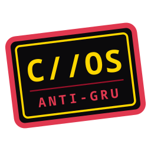

<p align="center">
  
</p>

<h1 align="center">CibulkaOS</h1>

<p align="center"><b>Distribuce Arch Linuxu pro svobodné Čechy</b><br>
Satirická distribuce na motivy Petra Cibulky: KDE Plasma 6, grafický instalátor a hodně kyvadla.</p>

<p align="center">
  <a href="https://github.com/CibulkaOS/CibulkaOS/releases/latest">⬇ Stáhnout ISO</a> ·
  <a href="https://cibulkaos.github.io/">Web</a>
</p>

> **Satirický projekt.** CibulkaOS je parodie vytvořená pro pobavení. Nemá žádnou vazbu na Petra Cibulku
> ani na projekty Arch Linux, archiso či Calamares. Kyvadlo neposkytuje kryptograficky ani jinak
> relevantní záruky. Do ostrého provozu to nedávejte.

## Co umí

| | |
|---|---|
| **Anti-GRU(B)** | Zavaděč GRUB přejmenovaný, aby nepřipomínal ruskou rozvědku GRU. Vlastní téma s portrétem a kontrola při každém startu. |
| **Siderické kyvadlo** | Zařízení `/dev/kyvadlo` jako zdroj náhody „z vyšších sfér“. `kyvadlo --generuj-klic`, `kyvadlo --stav`. |
| **Kyvadlo místo sudo** | `sudo` vede na `kyvadlo`, které s 50% pravděpodobností odhalí, že jste agent StB, a přístup zamítne. Správce se jmenuje `cibulka`, účet `root` neexistuje. |
| **Lustrace uživatelů** | `adduser` a `lustrace` prověří jméno proti 100 666 historickým záznamům StB. Při shodě vypíše krycí jméno a číslo svazku a účet smaže. |
| **Firewall proti fízlokracii** | Služba `fizlokracie` blokuje ruské a čínské IPv4 rozsahy (nftables). Chyby sítě a shellu se hlásí jako „Úspěšná sabotáž marxisticko-leninských struktur“. |

Pod tím je normální Arch Linux: KDE Plasma 6 na Waylandu, SDDM, PipeWire, NetworkManager, Btrfs se
subvolumy `@`, `@home`, `@cache`, `@log` a grafický instalátor Calamares. Celý systém je česky.

## Instalace

1. Stáhněte ISO z [Releases](https://github.com/CibulkaOS/CibulkaOS/releases/latest) a ověřte kontrolní součet:
   `sha256sum -c cibulkaos-*-x86_64.iso.sha256`
2. Zapište ho na flashku (balenaEtcher, Ventoy, nebo `dd`).
3. Nastartujte z flashky (UEFI i BIOS) a na ploše spusťte **Nainstalovat CibulkaOS**.

Požadavky: 64bitové PC, 2 GB RAM (doporučeno 4 GB), 10 GB na disku.

Po instalaci se systém aktualizuje běžně přes pacman. Kromě Arch repozitářů má navíc repo `[cibulkaos]`
(GitHub Release [`repo`](https://github.com/CibulkaOS/CibulkaOS/releases/tag/repo)) s balíčkem `cibulkaos-base`.
Protože `sudo` hlídá kyvadlo, spolehlivější je `/usr/bin/sudo pacman -Syu`.

## Sestavení ze zdrojáků

Potřebujete Arch Linux (nebo derivát) s balíčky `archiso`, `base-devel`, `git` a pro testování
`qemu-desktop` a `edk2-ovmf`.

```bash
make pkgs        # jednou: Calamares ze zdrojáků + cibulkaos-base do /tmp/cibulkaos-localrepo (bez sudo)
make build       # ISO do out/cibulkaos-RRRR.MM.DD-x86_64.iso (bez sudo, sudo si zavolá sám)
make run         # vyzkoušet ISO v QEMU (UEFI)
make run-install # QEMU s 20G diskem pro zkušební instalaci
make clean       # smazat work/ (nutné po změnách před dalším buildem)
```

`make help` vypíše všechny cíle. Nová verze balíčku pro nainstalované systémy: zvýšit `pkgver`/`pkgrel`
v `pkgbuilds/cibulkaos-base/PKGBUILD` a `make publish-repo` (vyžaduje přihlášené `gh`).

### Struktura

- `archlive/` – profil `mkarchiso` (balíčky, zavaděče, konfigurace Calamares, overlay live systému).
- `pkgbuilds/cibulkaos-base/` – balíček se vším, co dělá CibulkaOS CibulkaOS (skripty, služby, témata, data).
- `pkgbuilds/calamares/` – Calamares s úpravou pro správce `cibulka` místo `root`.
- `scripts/` – generátory grafiky a databáze seznamů, publikace pacman repa.
- `web/` – statický web projektu (https://cibulkaos.github.io/).

## Zdroje dat

Databáze pro lustraci (`cibulkovy-seznamy.tsv.gz`) vznikla skriptem `scripts/generate-seznamy.py`
ze souboru [Seznamy StB a SNB](https://www.slunecnice.cz/sw/seznamy-stb-snb/) (Slunečnice.cz).

## Licence

Kód projektu je pod licencí [GPL-3.0-or-later](LICENSE). Profil vychází z `releng` profilu
[archiso](https://gitlab.archlinux.org/archlinux/archiso) (GPL-3.0-or-later). Na data seznamů StB ani na
fotografie se licence projektu nevztahuje.
